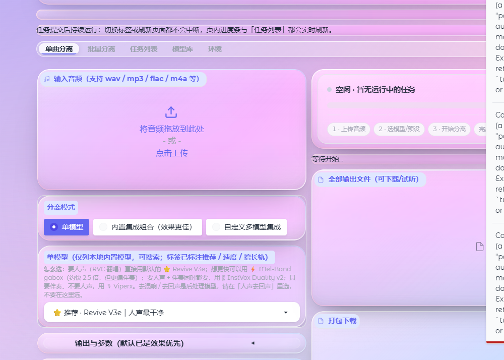
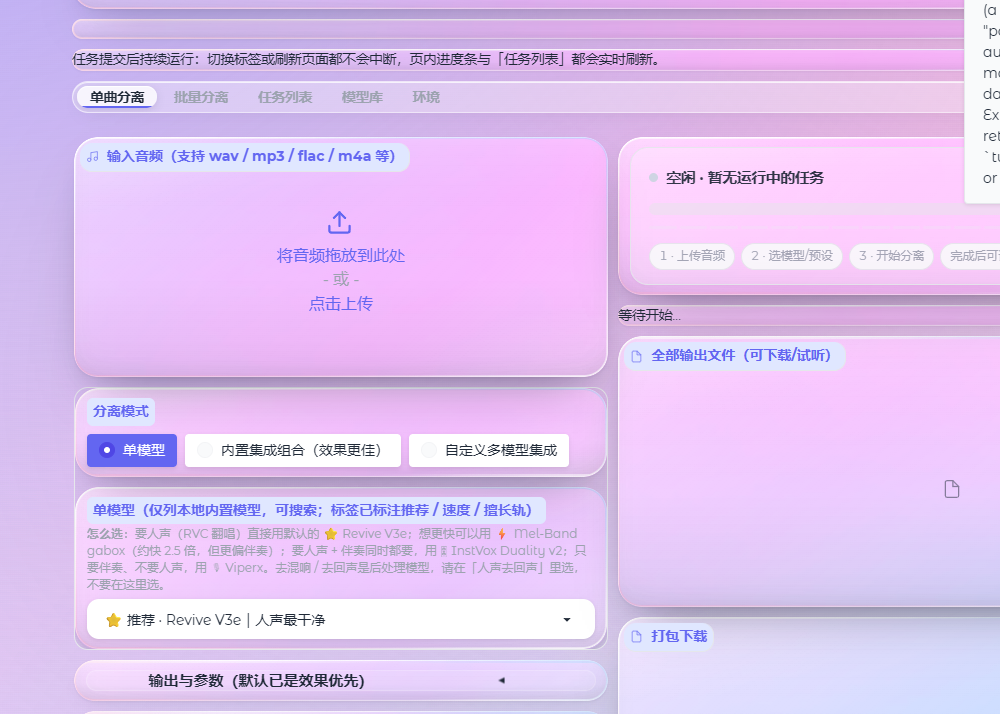
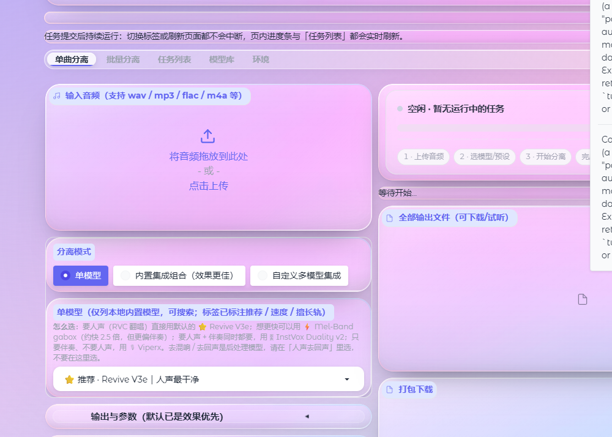
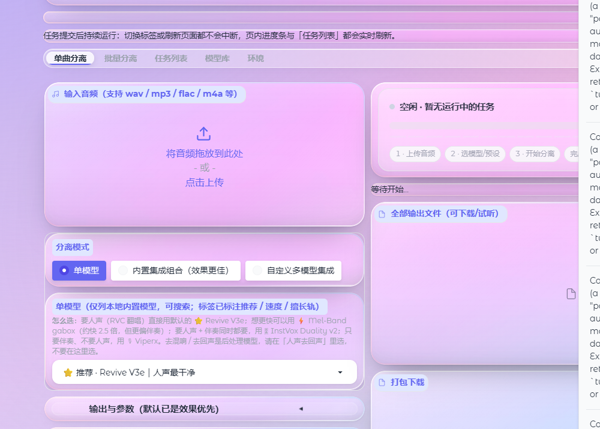

# 使用手册

面向使用者的完整操作说明。第一次用建议按顺序读完「快速开始」和「四个标签页」，其余按需查阅。

> 界面截图见仓库 `show\` 目录。若图片与你的实际界面有出入，以程序为准——截图可能来自较早版本。

---

## 目录

- [快速开始](#快速开始)
- [界面总览](#界面总览)
- [标签页一：单曲分离](#标签页一单曲分离)
- [档位怎么选](#档位怎么选)
- [参数详解](#参数详解)
- [人声去回声（RVC 翻唱必看）](#人声去回声rvc-翻唱必看)
- [标签页二：批量分离](#标签页二批量分离)
- [标签页三：任务列表](#标签页三任务列表)
- [标签页四：模型库](#标签页四模型库)
- [标签页五：环境](#标签页五环境)
- [暂停 / 继续](#暂停--继续)
- [输出与导出](#输出与导出)
- [下载后自动清理](#下载后自动清理)

---

## 快速开始

1. 双击 `start.bat`（或用桌面快捷方式 `VocalSeparator`）。
2. 浏览器自动打开 `http://127.0.0.1:7861`。
   - 用桌面启动器时，界面会装在一个**独立程序窗口**里，没有地址栏和标签页。
3. 在「单曲分离」页把音频拖进上传区。
4. 档位保持默认（**内置集成组合 · Revive V3e + BS-Roformer 1297**）就能得到很好的效果。
5. 点「开始分离」，等进度条跑完，右侧出现试听/下载。

首次启动需要加载模型和探测显卡，约 20~40 秒；之后启动更快。

> **关掉那个黑色命令行窗口就是退出程序。** 用桌面启动器则直接关窗口。

---

## 界面总览

程序共五个标签页：

| 标签页 | 用途 |
| --- | --- |
| **单曲分离** | 处理一首歌，出人声 / 伴奏等主干，在线试听 + 下载 |
| **批量分离** | 一次丢多个文件或整个文件夹，连续处理并打包下载 |
| **任务列表** | 所有任务的台账（含历史），可暂停 / 导出详情 / 打开输出目录 |
| **模型库** | 全部模型的 SDR 评分、主干定义、是否已内置 |
| **环境** | GPU / torch / CUDA / ONNX Runtime / FFmpeg 状态自检，性能调优 |

顶部还有一条**全局活动条**，任何页面都能看到当前有没有任务在跑。



*上图为「单曲分离」页的初始状态：左侧是上传区与档位/参数，右侧是进度区与输出区。*

---

## 标签页一：单曲分离

### 左侧：输入与设置

#### 输入音频

拖拽或点击上传。支持 `wav / mp3 / flac / m4a` 等常见格式（实际解码能力取决于内置 FFmpeg）。

#### 分离模式（三个档位）

- **单模型** — 只用一个模型跑一遍。最快，适合快速试听。
- **内置集成组合（效果更佳）** — 多个本地内置模型的频谱融合。**默认推荐**。
- **自定义多模型集成** — 自己勾 2 个以上模型 + 选融合算法。适合折腾。

选「自定义多模型集成」时才会出现「集成模型」多选下拉和「集成算法」下拉。

#### 模型 / 预设下拉

- 标签上已经标注了**推荐 / 速度 / 擅长轨**，下拉可搜索；
- 只列出**本地已内置**的模型——本工具不会联网下载模型；
- 想排除某个模型，看「模型库」页的「状态」列。

#### 输出与参数（折叠面板，默认收起）

默认值已经是「效果优先」，**第一次用不需要改**。详细含义见 [参数详解](#参数详解)。

#### 人声去回声（折叠面板，默认收起）

RVC 翻唱前置处理，详见 [人声去回声](#人声去回声rvc-翻唱必看)。

#### 高级推理选项（折叠面板，默认收起）

| 选项 | 默认 | 说明 |
| --- | --- | --- |
| native fp16 推理 | **开** | 实测输出与 fp32 逐样本一致，约快 6%~20% |
| torch.compile 编译加速 | 关 | 首次推理有编译预热耗时 |

除非排查问题，否则**保持默认**。

### 右侧：进度与输出


*进度区、状态文字、主干试听位（人声 / 伴奏等）、全部输出文件、打包下载，以及暂停 / 继续 / 清理按钮。*

- **进度条** — 真实进度（不是估算动画），见 [真实进度](#真实进度为什么进度条可信)。
- **状态文字** — 当前阶段，如「加载模型」「分离中」「2/2 人声去回声」。
- **主干 N** — 分轨试听播放器。没输出的轨道不显示。
- **全部输出文件** — 所有产物，可单独下载。
- **打包下载** — 一键下载 zip。

---

## 档位怎么选

从弱到强：

### 1. 单模型 · BS Roformer Vocals Revive V3e（`bs_roformer_vocals_revive_v3e_unwa.ckpt`）

内置模型里**人声最干净**的一档，RVC 翻唱首选，开箱即用。也是程序的默认单模型。

### 2. 单模型 · BS-Roformer Viperx 1297 / 1296

人声与伴奏**均衡**的经典档：

| 模型文件 | vocals SDR | instrumental SDR |
| --- | --- | --- |
| `model_bs_roformer_ep_317_sdr_12.9755.ckpt`（1297） | 11.8 | 16.5 |
| `model_bs_roformer_ep_368_sdr_12.9628.ckpt`（1296） | 12.96 | — |

其他内置单模型：

| 模型文件 | 定位 |
| --- | --- |
| `melband_roformer_instvox_duality_v2.ckpt` | 人声 + 伴奏双强（InstVoc Duality V2） |
| `mel_band_roformer_instrumental_fv7z_gabox.ckpt` | 专攻伴奏，约快 2.5 倍 |
| `mel_band_roformer_karaoke_aufr33_viperx_sdr_10.1956.ckpt` | 卡拉 OK：只要伴奏、不要人声 |

### 3. 内置集成组合（**推荐**）

多模型频谱融合，实测优于任意单模型。三个内置预设：

| 预设 | 成员 | 算法 | 特点 |
| --- | --- | --- | --- |
| **`builtin_vocal_revive`（默认）** | Revive V3e + BS-Roformer 1297 | `avg_fft` | 人声极致干净 |
| `builtin_vocal_dual` | BS-Roformer 1297 + 1296 | `avg_fft` | 双雄，稳定干净 |
| `builtin_vocal_triple` | 1297 + 1296 + InstVoc Duality V2 | `avg_fft` | 细节更饱满，更慢 |

代价是**每个成员模型都要跑一遍**，所以耗时大致与成员数成正比。

### 4. 自定义多模型集成

自由勾 2 个以上内置模型，配 `avg_fft` / `min_fft` / `max_fft` / `uvr_max_spec` 等融合算法。各算法含义见 [原理与架构 · 集成融合](原理与架构.md#三集成ensemble融合算法)。

> **社区预设（`vocal_full` / `instrumental_full` / `karaoke` 等 6 个）** 依赖额外权重，当前未内置，离线模式下**不会出现在列表里**；把对应权重放进 `models\` 后即会自动出现。

---

## 参数详解

点开「输出与参数」折叠面板：

| 参数 | 默认值 | 取值 | 说明 |
| --- | --- | --- | --- |
| 输出格式 | **WAV** | WAV / FLAC / MP3 | 无损首选；FLAC 省空间；MP3 便于分享 |
| 采样率 | **44100** | 44100 / 48000 | 与人声翻唱链路一致一般 44100 |
| 只输出指定主干 | 空 | 文本 | 留空 = 全部；填 `Vocals` 则只出人声 |
| 批大小 batch_size | **8** | 1~16 | 越大越快，**显存换速度**；16GB 显存可试 12~16 |
| 分段长度 segment_size | **0** | 0~1024，步长 64 | **0 = 跟随模型原生**，一般不动 |
| 重叠倍率 overlap | **4** | 2~64 | **官方默认 4**（与 Roformer 训练配置一致）；8 更保守、16 精细，越高越慢近似成正比 |
| Demucs shifts | **4** | 1~8 | 仅多轨模型（鼓/贝斯/钢琴），越高越精细、越慢 |
| Demucs overlap | **0.25** | 0.0~0.9 | 仅多轨模型 |
| 归一化阈值 | **0.9** | 0.0~1.0 | 透传给上游分离器 |
| 增益阈值 | **0.0** | 0.0~2.0 | 透传给上游分离器 |

### 关于 overlap 的实测结论（重要）

程序「环境」页有「实测对比」按钮，用你本机跑 6 组配置。作者机器上的结论：

- **CPU 线程数 / `cudnn.benchmark` / `batch_size` 差异 < 15%** —— 属同一档次。因为瓶颈在 GPU 推理本身，不是 CPU。
- **`overlap` 是最大的速度变量**：`8 → 32` 约慢 **4 倍**（同一段音频被重复推理更多份）。

**建议保持默认 4。** 只有在结果有可听的块边界瑕疵时才往上调。

> **官方默认值是 `overlap = 4`**（滑杆标签 `OVERLAP_LABEL`，`app.py:4822`），选它的原因是**与 Roformer 自身的训练配置一致**——偏离训练配置不一定更好。滑杆标签给的档位建议是：**4 默认 / 8 更保守 / 16 精细**。
>
> 仓库根目录旧 `README.md:39` 写「overlap 默认 32」、`app.py:18` 的历史改造说明写「32 -> 8」，**都是过时文案**，不是运行事实。

### 真实进度：为什么进度条可信

程序替换了推理库内部的 tqdm，直接读取**真实的分块计数**（`(n, total)`），而不是按时间瞎猜。所以：

- 进度条不会卡在 99% 不动；
- ETA 是基于真实块速率的估算；
- 进度**单调不减**，不会来回跳。

拿到库的内部计数时按真实比例换算；个别架构（Demucs / VR）拿不到时，退回按音频时长的经验估算。

---

## 人声去回声（RVC 翻唱必看）

### 为什么需要

带混响 / 回声的人声会让 RVC 翻唱模型**把残响也一起学成人声**，成品出现闷糊、回声叠加等错误。

### 工作流（两段式）

```
1/2 正常分离  ──▶  2/2 只对「人声」轨去回声
```

产物里会**多一份去回声的人声**，直接用这份做 RVC 输入即可。伴奏等其它主干不受影响。

**为什么必须只对人声轨做**：对整首歌做去回声会破坏伴奏；而且伴奏本来就不该被处理。

### 怎么开

在「单曲分离」或「批量分离」页展开「**人声去回声（可选 · RVC 翻唱前置，分离完成后自动执行）**」，勾选复选框。

### 选哪个模型

| 选项 | 性质 | 什么时候选 |
| --- | --- | --- |
| **去回声 · De-Reverb-Echo V2** | **治回声**，推荐 | **默认，RVC 翻唱就选这个** |
| 去回声 · Fused | 小混响 + 大混响通吃，官方推荐融合版 | 混响类型不确定时 |
| 去混响 · 标准 anvuew（SDR 19.17） | **只去混响**，去回声几乎无效 | 素材混响重、几乎没回声 |
| 去混响 · 轻柔 anvuew（SDR 18.81） | 更保守，保留更多原始质感 | 怕伤高频 / 混响很轻 |
| 去回声 · 双模型串联（V2 → Fused） | 最干净，**慢一倍** | 回声极顽固时才用 |

> **关键结论**：`anvuew` 系列是「去混响」，对**离散回声（延迟尾巴）几乎无效**——真实湿人声上 SDR 只有 15.1；Sucial 的 **De-Reverb-Echo 系列才是治回声的**，同一素材 SDR 24.3，且不掉电平、不掉高频。

### 遍数：用 1 遍

- **默认 1 遍，强烈建议保持。**
- 实测「2 遍」对回声的额外削减极小（`-8.48 → -8.52dB`，几乎听不出），却让**耗时翻倍**。
- 2 遍只在回声顽固到无法接受时手试。

### 两个开关

| 开关 | 默认 | 说明 |
| --- | --- | --- |
| **自动等响** | **开（建议保留）** | 把去回声产物拉回与分离人声同等音量。这些模型可能把整轨压低十几 dB，不做补偿就是「又小又对不上」 |
| 额外：补回 8kHz 以上空气感 | **关（保持关）** | **新去回声模型本来就不掉高频**，硬补等于把原人声里的回声高频灌回去，**越补回声越多**。只有用老式 anvuew 去混响时才考虑开 |

### 耗时预期

去回声是与分离**同量级**的额外一遍推理（只处理人声轨）。长音频请预留时间。

---

## 标签页二：批量分离

上传多个文件或整个文件夹，用同一套模型连续处理，结果自动打包。



*「批量分离」页：多文件上传、模式选择与参数面板，结构上与单曲页一致。*

与单曲页的差别：

- **只支持「单模型」和「内置集成组合」两种模式**（没有自定义集成）；
- 输入是 `音频文件 / 文件夹（可多选）`；
- 每个文件都把同一套参数跑一遍，进度条显示**整体进度**；
- 全部完成后打包成一个 zip。

**批量也有「人声去回声」选项**，勾选后每个文件都会在分离后对自身人声轨做一遍去回声。

---

## 标签页三：任务列表

任务台账（JSON 落盘）。**分离提交后持续运行，刷新页面或切换标签后依然能看到运行中与历史任务。**



*任务台账表格：模式、文件、状态、进度、耗时等；下方是操作按钮区。*

### 能做什么

| 按钮 | 作用 |
| --- | --- |
| 立即刷新 | 立刻拉一次最新状态 |
| 选择任务 | 下拉挑一个任务（用于打开输出目录 / 暂停 / 导出） |
| 打开输出目录 | 在资源管理器里打开该任务的输出目录 |
| 暂停选中任务 / 继续选中任务 | 对选中任务暂停或恢复 |
| 清理本机副本 | 删除该任务在 `output\` 的本机副本（送回收站） |
| **导出选中任务详情** | 导出该任务的完整详情文件 |
| **导出全部任务详情** | 导出所有任务的详情 |

导出后会在这下方出现「导出的详情文件（点击下载）」，点一下下载。

---

## 标签页四：模型库

共收录全部分离模型，含 SDR 评分、主干定义与内置状态。


*模型库表格：文件、名称、架构、最高 SDR、主干、状态。*

| 列 | 含义 |
| --- | --- |
| 文件 | 权重文件名——**放 `models\` 时用的就是这个名字** |
| 名称 | 模型的可读名 |
| 架构 | MDXC / MDX / VR / Demucs 等 |
| 最高 SDR | 分离质量指标，**越高越干净** |
| 主干 | 该模型能输出的轨（人声 / 伴奏 / 鼓 / 贝斯…） |
| 状态 | **已内置** / 未内置。离线模式下只有「已内置」可用 |

用法：在「筛选」框输入文件名或名称关键词，回车即过滤。点「刷新」重新扫描 `models\` 目录。

**未内置的模型需自行放入 `models\` 目录，本工具不会联网下载。**

---

## 标签页五：环境

GPU / torch / CUDA / ONNX Runtime / FFmpeg 状态自检。



*环境自检报告与「打开输出目录 / 打开模型目录」按钮。*

| 按钮 | 作用 |
| --- | --- |
| 刷新检测 | 重新生成自检报告 |
| 打开输出目录 | 打开 `output\` |
| 打开模型目录 | 打开 `models\` |

**重点看 `CUDA 可用`**：如果是 `False`，说明没走 GPU（或驱动/torch 有问题），分离会慢很多。见 [常见问题](常见问题.md#cuda-可用显示-false)。

### 性能：CPU / GPU 协同设置与实测（折叠面板）


*性能设置：CPU 线程数、cudnn.benchmark 开关，以及「实测对比」按钮。*

| 控件 | 说明 |
| --- | --- |
| CPU 线程数 | `0 = 自动`（交给 torch）。写入 `perf.json`，重启后仍生效 |
| cudnn.benchmark | 固定分段长度下自动选最优卷积算法 |
| 保存并应用 | 应用并持久化 |
| **实测对比** | 约 3~6 分钟，会占用 GPU。用你本机跑 6 组配置，给出对照表 + 结论 |

**实测对比会独占 GPU**，所以有分离任务在跑时点它会提示「已有分离任务在运行」。

> 这些开关都是**调度层**的调节项，**不改分离质量**。不同机器差异很大，**请用本机「实测对比」的数字做决定，不要照抄别人的结论**。

---

## 暂停 / 继续

单曲页、批量页、任务列表页都有「暂停」/「继续」按钮。

- 暂停**不会**卸载模型或释放显存——恢复后不会重跑已完成的块；
- 暂停状态会写进任务台账，所以刷新页面后仍是暂停状态；
- 暂停中的任务占着 `RUN_LOCK`，后面的任务会显示「排队」。

---

## 输出与导出

- 所有产物在程序目录下的 **`output\`** 里（界面「环境」页有「打开输出目录」按钮）。
- 每个任务的产物有独立的子目录。
- 页面上可单独下载文件，也可下 `打包下载` 的 zip。
- 文件名格式：`歌名_主干.ext`，主干是**中文**（人声 / 伴奏 / 鼓 / 贝斯 / 其他 / 吉他 / 钢琴）。
  - 上游默认是 `歌名_(主干)_模型名.wav`，程序做了中文重命名；
  - 重命名失败（如文件被占用）时保持原名，不报错。

---

## 下载后自动清理

**从页面点下载后，程序会把 `output\` 里那一份本机副本自动清理掉**，避免同一份文件占两份空间。

- 删除是**送进回收站**，不是硬删——误删可以还原；
- 浏览器里已经下载到「下载」文件夹的那份**不受影响**；
- 想手动清理：单曲 / 批量页的「清理本机副本」按钮，或任务列表页的「清理本机副本」。

> 用桌面启动器（原生窗口）时，「保存文件」是**把本机文件复制到你的「下载」文件夹**——因为 WebView2 默认不处理下载。这条路不走网络，更快也更稳。

---

## 相关文档

- [常见问题](常见问题.md) — 遇到问题先看这里
- [部署与打包](部署与打包.md) — 安装、换机器、打包发布
- [原理与架构](原理与架构.md) — 想搞清楚内部怎么实现的
